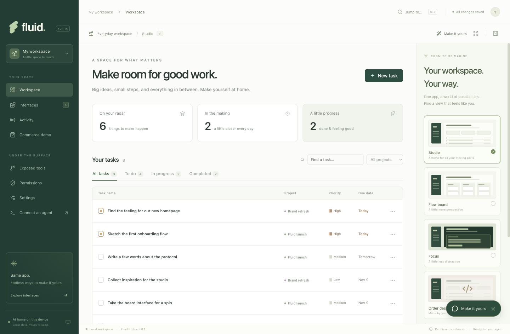
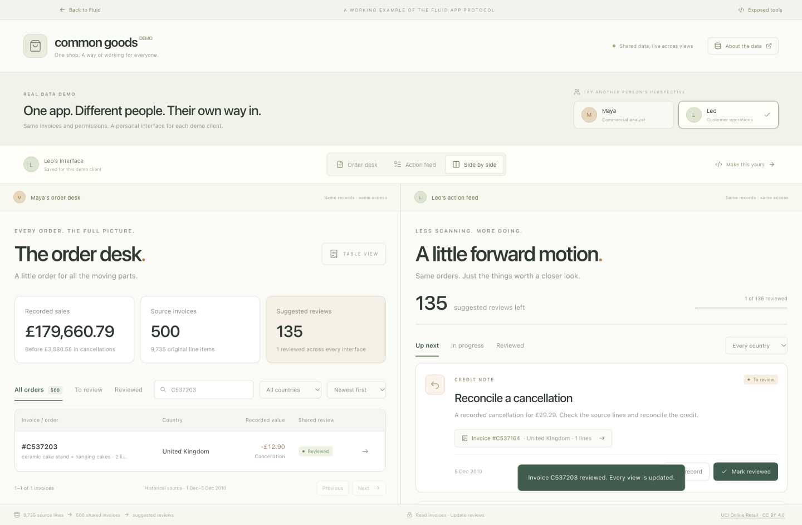

# Fluid

**Build desktop apps with an interface users can replace.**

Fluid is an experimental open-source app protocol with a Rust core and a working desktop reference app. Each app owns its host, native integrations, data, and behavior. Its entire workspace frontend is a replaceable, versioned artifact. Users and authorized agents can read the source, publish a new interface, and keep using the same underlying app.

**Alpha 0.3.0-alpha.1.** [Download the alpha](https://github.com/LiorKaufman/fluid/releases/tag/v0.3.0-alpha.1) or read [build instructions and platform status](docs/ALPHA.md). Archives are unsigned; the platform matrix must pass before distributing builds for that platform.



## Try it

Building from source requires Rust 1.97+ (tested with 1.97.1), a C/C++ toolchain for bundled SQLite, Node.js 22.12+ (Node 24 recommended), and npm. Packaged apps include the native host and need no Rust or Node installation.

```sh
npm install
npm run desktop
```

To build and run the production desktop application:

```sh
npm run build
npm start
```

To create an unpacked, locally runnable desktop application:

```sh
npm run package
```

To create an unsigned alpha archive and its SHA-256 checksum:

```sh
npm run package:alpha
npm run test:packaged -- --archive
```

Build on the destination operating system. Packaging compiles Rust for the selected Electron architecture, stages a target-specific host, and verifies its version and checksum in the packaged resources. See [the supported build matrix](docs/ALPHA.md).

The app starts with sample tasks. Changes are saved locally, across restarts.

## See the idea in action

1. Create a task in **Studio**.
2. Switch to **Flow board**, then **Focus**. Your task is the same underlying record.
3. Click the **Make it yours** helper button and describe a change. Automatic connection reuses an available Codex or Claude Code sign-in; configure APIs or local models in **Settings**.
4. Review the proposed code or choose **Review & use**, approve its requested access, and use it with your real workspace. You can also write or import HTML/CSS/JavaScript through **Interfaces**.
5. Open **Permissions** and revoke its read or write access. The app core enforces the decision, including for existing sessions.
6. Return to Studio at any time. The shipped interfaces remain available as a fallback.
7. Open **Exposed tools** to inspect the live tool list, schemas, grants, and reasons tools are unavailable for each frontend or external agent.
8. Choose **Use full canvas** to let the interface fill the app window. **Open app controls** restores the trusted controls.

Custom frontends are self-contained `.fluid.json` files. Export, share, edit, and import them through Interfaces. Fluid keeps the last ten previous versions of each custom frontend; the restore button saves a previous version as a new revision. An imported frontend receives no grants until the user explicitly selects them. Imports do not execute during installation.

## A real-data commerce example

Open **Commerce demo** to try **Common Goods**: 500 complete historical invoices transformed from 9,735 real UCI retail lines.

Maya's **Order desk** is a searchable table. Leo's **Action feed** turns the same records into suggested reviews for cancellations, missing customer references, pricing exceptions, and large orders. Each demo client keeps its own interface choice. Mark a review complete or add a note in one view, and the other updates from the same Rust host.

Choose **Side by side** to watch this happen, **About the data** for source provenance and transformation rules, or **Make this yours** to fork the frontend. The prepared data is attributed under CC BY 4.0. These are demo client profiles on one local host; authenticated team accounts remain future work.

See [the walkthrough, data pipeline, and scope](docs/COMMERCE-DEMO.md).



## The frontend SDK

Every interface, including the default, uses the same injected SDK:

```js
const { tasks } = await fluid.call('tasks.list');

await fluid.call('tasks.update', {
  id: tasks[0].id,
  status: 'done',
});

const unsubscribe = fluid.subscribe(async () => {
  // A change signal: read current state again.
  const { tasks } = await fluid.call('tasks.list');
  render(tasks);
});
```

Use `workspace.describe` to discover the typed capability contract, domain meanings, and current grants. `tools.inspect` reports exactly which tools the caller can use. Both are backed by the same Rust registry that executes calls. See [the protocol](docs/PROTOCOL.md) and [an example custom frontend](examples/reading-room.fluid.json).

## Bring your own agent

The built-in **interface helper** connects to the intelligence you already use:

| Connection            | Setup                                                                                                                                                                                                                                            |
| --------------------- | ------------------------------------------------------------------------------------------------------------------------------------------------------------------------------------------------------------------------------------------------ |
| Codex                 | Automatically detects an installed CLI or the bundled CLI in ChatGPT/Codex on macOS, and reuses its existing sign-in.                                                                                                                            |
| Claude Code           | Automatically detects an installed, signed-in Claude Code CLI.                                                                                                                                                                                   |
| OpenAI API            | Add a key and model in Settings, or supply `OPENAI_API_KEY` and `OPENAI_MODEL` when launching Fluid. Uses the Responses API with structured output.                                                                                              |
| Anthropic API         | Add a key and model, or supply `ANTHROPIC_API_KEY` and `ANTHROPIC_MODEL`.                                                                                                                                                                        |
| OpenAI-compatible API | Set a base URL, model, and optional key. Supports local servers such as LM Studio and compatible remote endpoints. Environment configuration uses `FLUID_API_BASE_URL`, `FLUID_API_KEY`, and `FLUID_MODEL`; the base URL in Settings must match. |
| Ollama                | Detects a running local server and downloaded models. Uses the first available model unless you choose one.                                                                                                                                      |

**Automatic** prefers an authenticated local agent, then a configured API, then a local model. Detection reads supported CLI authentication status and connection configuration; it does not copy browser cookies or extract credentials from other apps. A subscription to an arbitrary web chat product is not a universal API credential. Additional subscriptions require a supported provider integration. API model access is verified only when a request completes; merely detecting a key does not verify its entitlement.

Choose **Settings → Show helper chat button** to show or hide the floating helper across the entire app. The preference and selected connection survive restarts. Hidden chat remains accessible by enabling the setting again. Conversation text stays in memory for the current app session.

The helper sends your request, the active frontend source, the capability contract, and up to ten recent chat messages to the selected provider. It does not query or attach task records. Generation creates a proposal; it does not execute the generated code or modify the workspace. **Review & use** installs it through the regular permission review. Existing interface history supports restoring changes. Requests can be stopped.

API keys entered in the desktop app are stored separately using Electron's OS-backed `safeStorage` encryption. If secure encryption is unavailable, including Linux's `basic_text` backend, keys remain in memory only. The browser preview always keeps entered keys in memory. Custom-endpoint keys are bound to their base URL and are not reused after changing the destination. Keys never enter frontend code, the capability manifest, or shared app state.

### Let an external agent operate the app

Open **Connect an agent**, enable access, select permissions, and choose a transport:

- **Native MCP over stdio:** Copy the configuration into an MCP-compatible client. The bundled Rust executable runs as `fluid-host mcp`; it needs no Node runtime.
- **MCP Streamable HTTP:** Connect directly to the native host's `/mcp` endpoint using the displayed bearer configuration. It supports standard MCP initialization, tool discovery, and calls.
- **WebMCP:** When `document.modelContext` is available, the app registers only tools exposed under the active frontend's grants. This is feature-detected; the external MCP adapters work independently.

Any compatible agent can inspect and operate the app within user-selected grants. Enable **Read interface source** and **Publish and switch interfaces** for full frontend editing: `frontends.list/get/put/activate/restore`. Publishing requires an expected version to prevent lost edits. An agent can activate its interface in full-canvas mode, but new artifacts receive no data permissions until the user grants them. Agents cannot expand grants, read provider keys, or replace shipped recovery copies. The connection token changes after each app restart; keep Fluid open while connected.

**Exposed tools** shows the actual caller-specific registry, including unavailable tools and their reasons. Export its manifest or inspect individual input/output schemas. All external clients currently share one agent profile; separate identities and grants for individual clients are future work.

No AI account or API key is required for the task app and manual interface editor. The helper uses a real connected provider; Fluid does not bundle a language model or simulate generation.

## Architecture

```text
Each desktop app
  ├─ Rust protocol: renderer-neutral wire types and generated TS bindings
  ├─ Rust host: validated tools, sessions, permissions, SQLite, activity
  ├─ Trusted shell: interface installation and permission controls
  ├─ Helper chat: provider discovery, code proposals, settings, encrypted keys
  ├─ Sandboxed frontends: default, board, focus, user-generated code
  └─ Agent adapters: WebMCP, native stdio MCP, Streamable HTTP MCP
```

`crates/fluid-protocol` defines app-independent wire types. `crates/fluid-host` implements this app's domain, registry, authorization, persistence, and native transports. Rust generates `src/protocol/generated.ts`, `contract.json`, and `defaults.json`; TypeScript adapters contain no duplicate domain implementation. `src/runtime` connects arbitrary frontend code to the host. Electron remains the trusted desktop shell, and Node handles existing provider integrations and OS-backed key encryption. React is used only in the shell.

This is a **v0.3 reference app using protocol v0.1**, with one app, one user, local SQLite storage, self-contained offline frontends, and exact protocol-version matching. The app-specific host is an example to adapt for a different domain; this repository is not yet a published SDK. Frontend sandboxing has not had a full security audit. Native desktop code and local processes remain trusted. See [architecture and limits](docs/ARCHITECTURE.md) and [the Rust implementation](docs/RUST.md).

## Development

```sh
npm run dev        # Browser preview, http://127.0.0.1:5173
npm run check      # TypeScript
npm run test:native # Rust host: transactions, grants, lifecycle, migration
npm run check:native # Clippy, all targets, warnings denied
npm test           # Rust integration, APIs, authorization, real MCP clients
npm run build
npm run test:e2e   # Production Electron app, isolated temporary data
```

The browser preview runs the same native host with a separate `.fluid/dev-state.sqlite` database. `npm run dev` builds the Rust binary and generates bindings first. Preview host management is protected from cross-origin browser requests, but remains a development convenience.

Desktop data defaults to Electron's user-data directory (`~/Library/Application Support/Fluid Workspace/workspace.sqlite` on macOS). Existing `workspace.json` and development `dev-state.json` data migrate once into SQLite; original JSON files remain untouched. Set `FLUID_DATA_DIR` to choose another directory. Tests use temporary databases and refresh the screenshots in `docs/`.

## Contributing

Start with [the protocol](docs/PROTOCOL.md). Useful next areas include a second app with a different data model, capability compatibility negotiation, signed frontend distribution, and a broader sandbox review. Protocol changes should include an interoperable example and tests through the public host interface.

MIT licensed. See [LICENSE](LICENSE).
